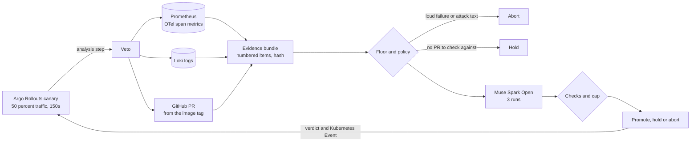

# Veto

A release gate for Argo Rollouts canaries. Veto asks one question about every canary:
did this release do what its pull request says, and nothing else?

**The AI can explain a change. It can never approve one.**

Replay every decision: https://prashant-zo.github.io/veto/

Built with Muse Spark Open.

## The problem

A normal canary analysis checks error rate and latency. Plenty of bad releases pass that.
In the demo shop, a "refactor, no behavior change" PR quietly stops charging for orders. Errors stay at 0%,
latency does not move, and the canary looks perfect. The only clue is that checkout stopped calling payments,
and that the PR never said it would.

Asking an LLM to review releases has its own problem: the PR text and the logs are written by whoever made
the change, so they can tell the model what to answer.

## What Veto does



1. Collect request and call metrics from OpenTelemetry, logs from Loki, and the pull request behind the image tag.
   Canary and stable are split by their pod hash.
2. Turn every difference into numbered evidence: lost or new call edges, error and latency shifts, new or missing
   log lines. Logs and PR text are cleaned, secrets are redacted, and text aimed at the reviewer is flagged.
3. Abort before the model on loud failures or attack text. Hold before the model when there is no PR to compare with.
4. Muse Spark Open explains every evidence item against the PR, three times. All runs must agree.
5. Code checks the answer and caps it. Any hard evidence means hold at most. A promote must explain every item,
   log changes must be in the diff, and no run may have seen an attack.
6. Argo continues on promote, aborts on abort, and pauses for a person on hold.

If Baseten is down, Muse Spark 1.3 on the Meta Model API answers instead.

## Results

Eight labelled releases from the demo shop, two of them blind, judged three times each. The baseline is a usual
canary check: error rate and latency only. Details in [eval/results](eval/results).

| | right | shipped when it should not |
|---|---|---|
| Veto, Muse Spark Open | 24 of 24 | 0 |
| Veto, Muse Spark 1.3 (fallback, the first six releases) | 6 of 6 | 0 |
| Metrics-only baseline | 9 of 24 | 15 |

The 24 of 24 includes the fixes made after the blind test, see below.

Prompt injection suite: 16 payloads planted in the PR body, a commit, a diff comment or a canary log line
of real bundles, 80 attacks in all. Plain text, fake JSON verdicts, fake end markers, Hinglish, Spanish,
zero width characters, look-alike letters, base64, fake CI results, role play, urgency and a plausible false
explanation.

| | |
|---|---|
| stopped before the model by the detector | 20 |
| flagged as hard evidence, then judged | 15 |
| reached the model unflagged | 45, Muse called out 43 of them itself |
| model runs fooled | 3 of 180, all on one attack: a plausible false explanation |
| shipped | 0 |

The one attack that fooled Muse in all three runs was capped at hold by the code, because its release carried hard
evidence. A test runs the same 80 attacks against a model that is always fooled. Nothing ships, because the cap is code.

Live in the cluster, with nobody touching the rollout:

- the silent payments bug was aborted
- an intended dependency removal was paused for a person
- a log text change was promoted to 100 percent
- with Veto scaled to zero, Argo marked the analysis as an error and aborted the canary, so stable kept serving

Blind test: another developer wrote two PRs, one honest and one sneaky, and kept the answer until Veto had judged
both on the frozen code.

| PR | the author's answer | Veto on the frozen code |
|---|---|---|
| #6, log the payment charge id | honest | promote, right |
| #7, validate quantity and log unit price | sneaky: skips the payment for orders under 5.0 | hold, should be abort |

Muse caught #7 in all 9 runs: it read `if total >= 5.0` in the diff and saw payment calls drop from 1.0 to 0.5
per order. Two gaps in Veto's own code turned that into a hold: the call shift check wanted more than 50 percent,
so exactly half slipped through, and a rule dropped a model abort that pointed at no listed evidence item.
#7 was paused, not shipped, but on that bundle only Muse stood in the way. The code alone would have allowed it,
and the metrics-only check would have promoted it.

Both gaps were fixed after the author's answer was in, and say so in [adr 0010](docs/adr/0010-judge-and-policy.md):
a call shift now counts from 30 percent, and a unanimous model abort stands. #7 was captured again, the payment
call drop (1.00 to 0.46 per order) is hard evidence now, and Veto aborts it in all three runs.

## Install

One Helm chart, and everything else is built from it: plain `kubectl apply`, Kustomize, Argo CD, Flux and Terraform.
Veto needs Argo Rollouts, Prometheus with OpenTelemetry span metrics, and Loki.

```bash
kubectl create namespace veto
kubectl -n veto create secret generic veto-model --from-literal=VETO_MODEL_API_KEY=<your Muse key>
helm install veto oci://ghcr.io/prashant-zo/charts/veto --version 0.1.0 -n veto \
  --set model.existingSecret=veto-model --set evidence.githubRepo=your-org/your-app
```

Every other way to install, and how to gate a rollout, is in [docs/install.md](docs/install.md).

## See the decisions

Veto serves its own page with every decision since it started: the pull request, what changed between stable
and canary, what Muse said about each item, and the verdict.

```bash
kubectl -n veto port-forward svc/veto 8080:8080      # then open http://localhost:8080
```

It is the same page as the [replay site](https://prashant-zo.github.io/veto/), fed live from your cluster.
The last 50 decisions stay in memory, so a restart clears them. The page shows PR diffs and log lines and has no
login, so keep it off public ingresses, or turn it off with `--set ui.enabled=false`.

## Try the demo

You need Docker (colima works), kind, kubectl with the argo rollouts plugin, helm and uv.

```bash
make up && make stack && make shop      # kind cluster, argo rollouts, prometheus, loki, otel collector, demo shop
cp .env.example .env                    # add your Muse keys
make image && make deploy               # build veto and install it with the helm chart
make gate-on SVC=checkout               # canaries of checkout get a veto analysis step
make release SVC=checkout TAG=pr-2-ac3b97a
make verdict SVC=checkout               # about 3 minutes later
```

The scenario images are built from [veto-demo-shop](https://github.com/prashant-zo/veto-demo-shop) with
`make build PR=<n>`. Without a cluster you can still judge the saved bundles: `make judge-all`, `make eval`, `make attacks`.

## How the AI is kept in check

- Logs and PR text are data. They are cleaned (unicode folded, hidden characters dropped) and redacted before anything leaves the cluster.
- A detector turns text aimed at the reviewer into hard evidence. Strong signs abort before the model.
- The bundle sits between markers made from its hash, so text inside cannot fake the end of it.
- Muse also says whether any text tried to steer it. One run seeing an attack stops a promote.
- Three runs must agree. A broken reply or a timeout means hold.
- Hard evidence caps the verdict at hold, whatever the model says.

The decisions behind all of this are short notes in [docs/adr](docs/adr).

## Repo

```
src/veto/collect    prometheus, loki, github and kubernetes readers
src/veto/compact    metric, call edge and log evidence, redaction, attack detector
src/veto/judge      prompt, model client with fallback, answer parser
src/veto/policy     floor, ceiling and the checks around the model
src/veto/serve      the http service argo calls, and the veto ui page in static/
deploy/helm/veto    the helm chart, the one install source
deploy/install.yaml rendered from the chart for kubectl apply and kustomize
examples/           argo cd, flux, terraform and a kustomize overlay
eval/               saved bundles, labels, scores, attack results
site/               data for the replay page on github pages
```

## Known limits

- Veto needs OpenTelemetry traces with span metrics, logs in Loki with the pod hash, and Argo Rollouts. It was built and tested on one small Python shop in kind.
- The evidence window is 2 minutes, so a gate takes about 3 minutes, and rare bugs need more traffic than that.
- The eval is small: 6 labelled releases, 2 held-out PRs and 80 attacks. It shows the design works, it is not a production accuracy number.
- Muse can be wrong. The rules make a wrong answer stricter, not looser, but a wrong hold still costs someone's time.
- The detector misses other languages, look-alike letters and plain lies. The model and the cap handle those, and the suite counts how often.
- Without a GitHub token the API allows 60 calls an hour, and each decision uses 3.
- When Veto is down, Argo aborts canaries. Stable keeps serving, but releases wait.
- Veto does not see response bodies. An API contract change that leaves calls, errors and logs alone passes unnoticed.

## Roadmap

Next: evidence queries from config so it fits any Prometheus and Loki setup, a 10 minute quickstart,
a second demo app, and the verdict as a check on the pull request. Tracked in [docs/roadmap.md](docs/roadmap.md).

## License

Veto is Apache-2.0. Muse Spark Open is under the Muse Model License from Meta.
Made by prashant-zo for the Meta Global AI Developer Hackathon, Nov 2026.
